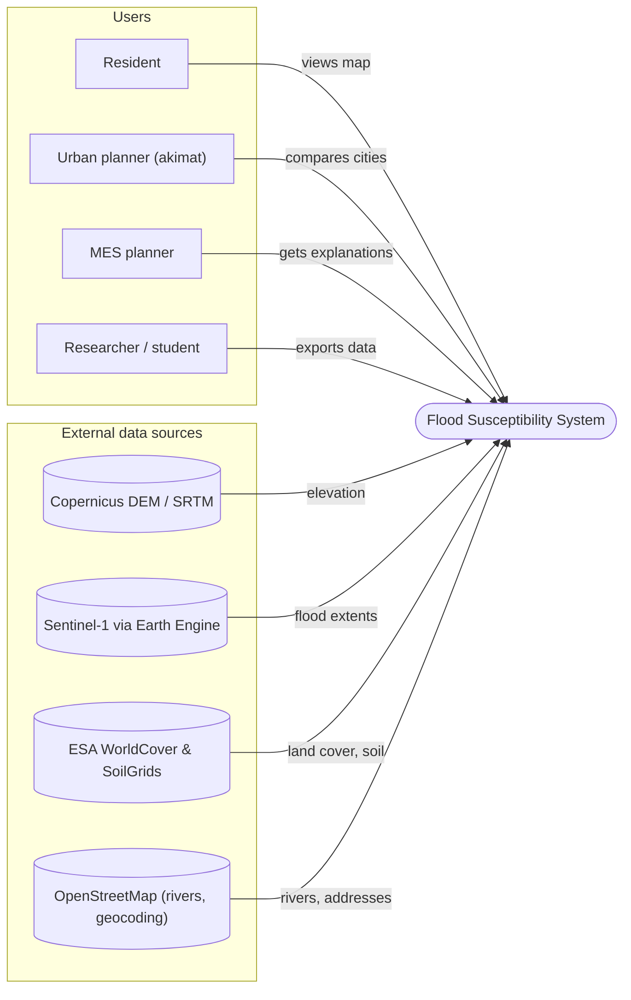
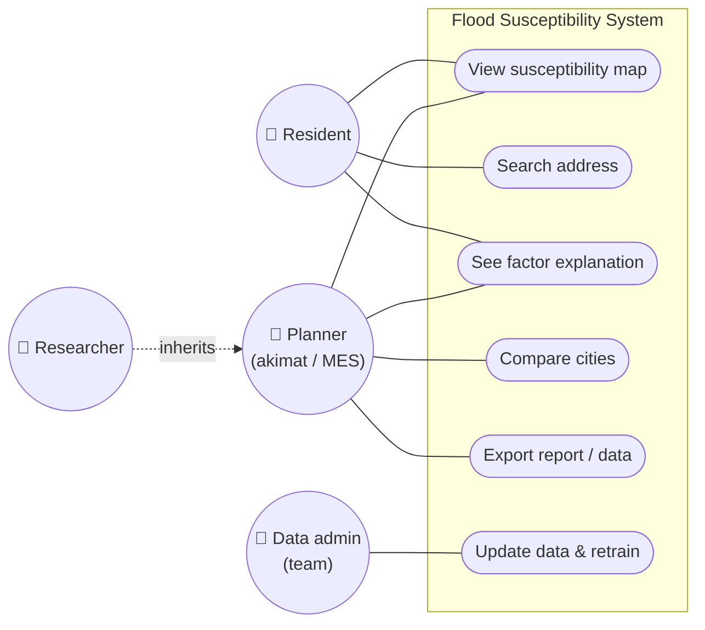
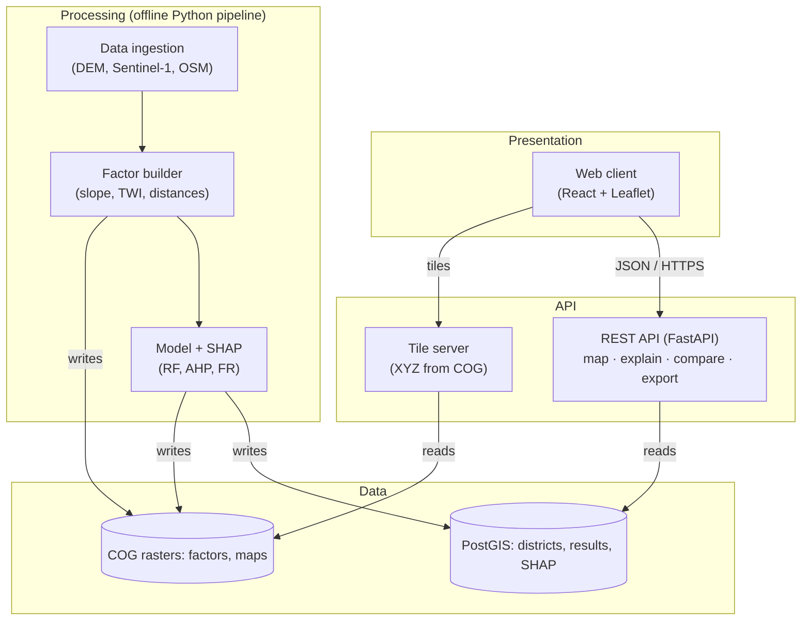

# Architecture diagrams

Editable sources are the `.mmd` files in this folder (Mermaid). GitHub renders them below; PNG exports used in the pre-defense presentation (slides 14–16) are in `exports/`.

Taiga task: #12 «Диаграммы архитектуры». Owner: Tenglesbayev Zhandos.

## System context diagram

Who uses the system and which open data sources feed it.

Source: [`system-context.mmd`](system-context.mmd) · Export: [`exports/system-context.png`](exports/system-context.png)

## Use case diagram

What each actor can do. The Researcher inherits all Planner use cases.

Source: [`use-case.mmd`](use-case.mmd) · Export: [`exports/use-case.png`](exports/use-case.png)

## Component diagram (first draft)

How the system is split into layers. Processing runs offline as a Python pipeline and writes to the data layer; the API only reads.

Source: [`component.mmd`](component.mmd) · Export: [`exports/component.png`](exports/component.png)

## How to update

1. Edit the `.mmd` file (preview at https://mermaid.live).
2. Export PNG to `exports/` with the same name.
3. Update the slide in the presentation if the diagram changed.
