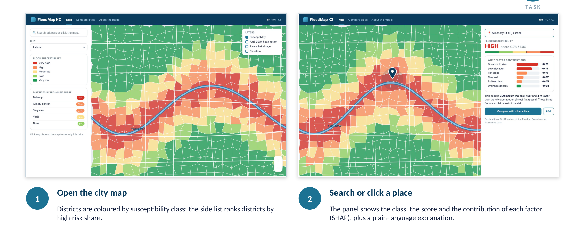
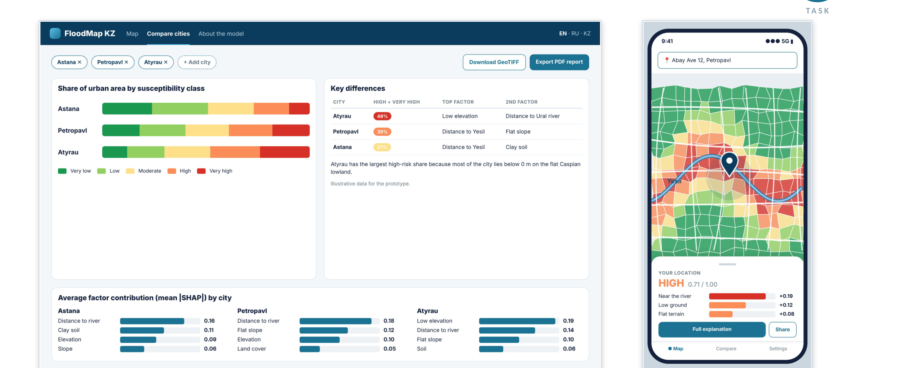
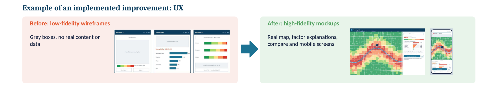

# Prototype

Taiga: #13 «UX-макеты и кликабельный прототип в Figma».

High-fidelity mockups of the key user scenarios. Mockups use illustrative data. A clickable Figma prototype is in progress; the link will be added here.

## Scenario 1 (resident): "Is my district at risk, and why?"

Open the city map → search an address or click a place → see the class, the score and the contribution of each factor (SHAP) with a plain-language explanation.

**Target:** a first-time user answers "is my district at risk and why" in under 60 seconds (NFR Usability).



## Scenario 2 (planner): compare cities

Add cities → compare the high-risk share → see top factors → export PDF or GeoTIFF. A mobile view was added because survey respondents asked for it.



## Iteration after supervisor feedback

Low-fidelity wireframes (grey boxes, no data) were replaced by high-fidelity mockups with a real map, factor explanations, comparison and mobile screens.



## Planned API (draft)

The web client talks to a FastAPI service. Draft contracts used in the mockups:

```http
GET /api/v1/cities
→ [{"id": "astana", "name": {"en": "Astana", "ru": "Астана", "kk": "Астана"}, "bbox": [71.2, 51.0, 71.7, 51.3]}]

GET /api/v1/explain?lat=51.128&lon=71.430
→ {
    "city": "astana",
    "district": "Yesil",
    "score": 0.78,
    "class": "high",
    "factors": [
      {"name": "distance_to_river", "value_m": 320, "shap": 0.21},
      {"name": "elevation_rel_m", "value": -4, "shap": 0.15},
      {"name": "slope_deg", "value": 0.4, "shap": 0.10},
      {"name": "soil_clay_pct", "value": 38, "shap": 0.07},
      {"name": "built_up", "value": true, "shap": 0.05},
      {"name": "drainage_density", "value": 0.9, "shap": -0.04}
    ]
  }

GET /api/v1/compare?cities=astana,petropavl,atyrau
→ [{"city": "astana", "class_share": {"very_low": 0.22, "low": 0.25, "moderate": 0.21, "high": 0.18, "very_high": 0.14}}, ...]

GET /tiles/{city}/{z}/{x}/{y}.png          # susceptibility layer (XYZ from COG)
GET /api/v1/export/{city}?format=pdf|geotiff
```

Values above are illustrative.
